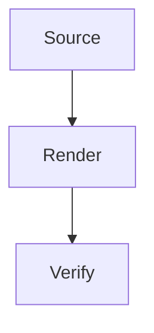

# Reliable Rendering

This original article exercises the conversion pipeline without relying on
another checkout, external images, or remote diagram services. Its text may be
redistributed under the repository license.

## Code and Typography

Use **strong text**, _emphasis_, ~~deleted text~~, and `inline code` in prose.
Escaped symbols such as \*literal stars\* must retain their meaning.

```typescript
interface Article {
  title: string;
  published: boolean;
}
const draft: Article = { title: '<Draft & review>', published: false };
console.log(draft);
```

```swift
struct ReadingProgress {
    let completed: Int
    let total: Int
}
```

## Lists and Tables

- Prepare the source
  - Review the title
  - Check the references
- Render the article

1. Inspect the preview
2. Publish after verification

- [x] Original fixture checked in
- [ ] Remote acceptance observed

| Capability                |  Desktop  |                  Mobile |
| :------------------------ | :-------: | ----------------------: |
| Long code and wide tables | Supported | Horizontally scrollable |
| Inline math and captions  | Supported |              Responsive |

> [!NOTE]
> Base capability styles must survive theme application.

> [!WARNING]
> Verification evidence must describe the actual environment.

## Media and References


---

The inline expression $x+y$ and the display expression below use injected
render services during this portable regression test.

$$
E = mc^2
$$



Read the [external reference](https://example.org/reference) and the
[official article](https://mp.weixin.qq.com/s/fixture). The former becomes a
footnote; the latter remains a native link.

## Final Review

An article combines text and structure. A successful conversion preserves
both: lists stay compact, code remains readable, captions stay near their
images, and tables allow horizontal scrolling on narrow screens.

The fixture is deliberately self-contained. Changes to a neighboring blog,
its file count, or its checkout location cannot alter the default test suite.
